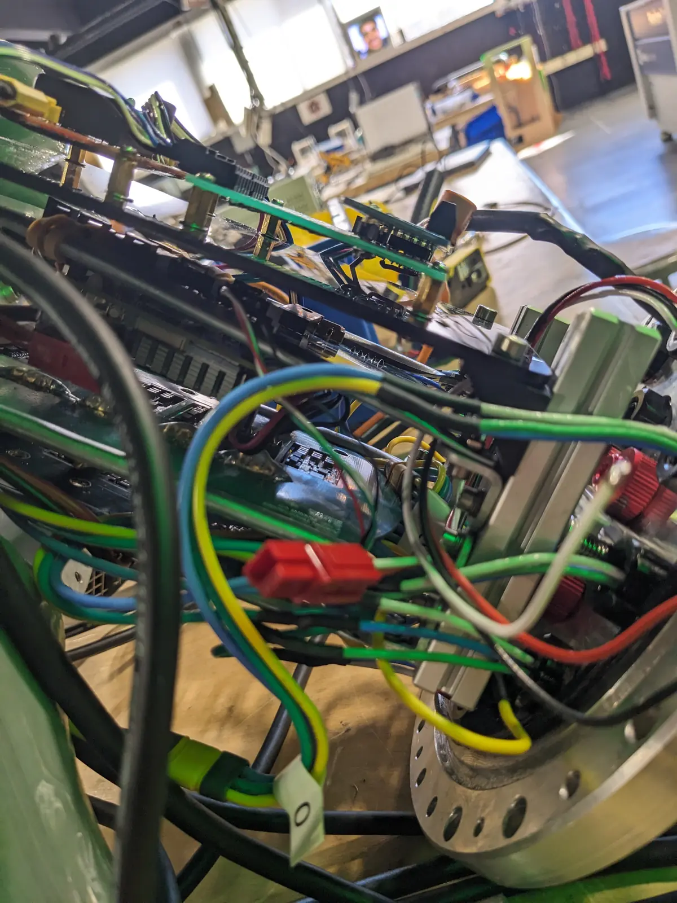
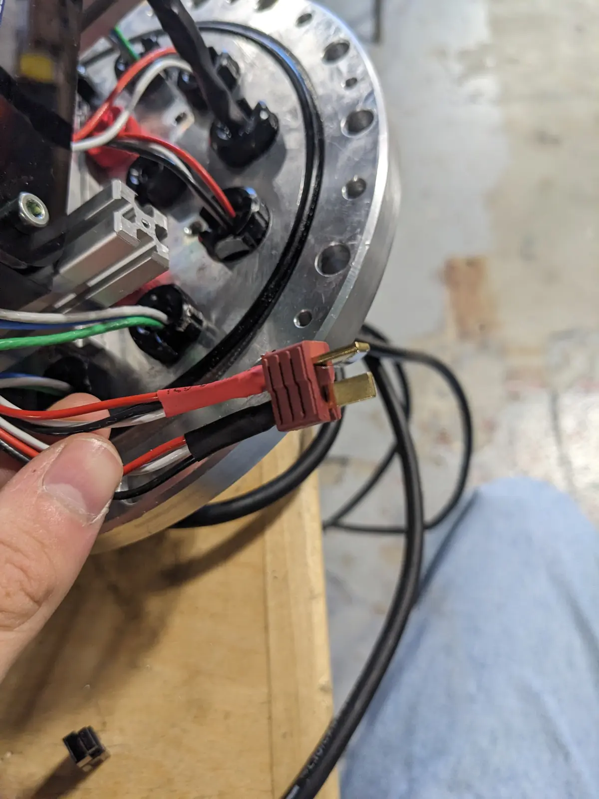

***

This week in shop was exciting, and we got quite a bit done on the new ROV! First of all, I want to say thank you to Alachie for coming in to shop over their week of, as it was a great help to us!

On Tuesday (no school Monday), Tim and I worked hard on trying to get the electronics working reliably. This proved to be a bit difficult as we were struggling to get everything to be compact enough to fit inside the ROV... This is all temporary however, and we really just wanted to see it moving in water so we could prove to ourselves (and colleges) that the robot is functional and can move under its own power. 

Originally, we had two Anderson power pole connectors inside the ROV in order to provide power to the boards and everything inside. This was the weak link and I discovered that they weren't making a great connection. I really wanted to use an XT60 or XT90 as I prefer them to power poles, but all I could find in the shop were deans connectors. They are rated for the power, but I don't think they are quite as safe...

After this, things were going pretty smoothly, and with the help of Tim, I was able to fit everything into the tube!

On Thursday, Alachie was able to stay after and after trials and tribulation, was able to get my custom STM32 board working properly! This was a super exciting moment for me, as I had never designed a board quite like this, and to see it working was extremely validating.

The video below demonstrates a "simple" blinking code (it was \~150 lines of code) running on the microcontroller and turning the on board LED on and off! 

 

 
  
        
        <video width="60%" controls muted>
            <source src="/posts/10-12-26/blink_web.mp4" type="video/mp4">
            Your browser does not support the video tag.
        </video>                                                                          
         

 

 

Finally, on Thursday, Tim and I put the ROV into our dumpster full of water and were able to try out the ROV's movement! It actually worked! There are some bugs and issues that I noticed. For example, the thrusters are all plugged in randomly, but a simple software adjustment can fix that. Also, the motors on occasion will get stuck at their current throttle position and the ROV loses connection and doesn't respond to the controller. I think this is a power issue where the thrusters draw too much current, and the PI 5 reboots and the PWM controller keeps its state without turning the motors off. I'll have to investigate into this one a bit more!

 

 
  
        
        <video width="60%" controls muted>
            <source src="/posts/10-12-26/rov-demo_web_web.mp4" type="video/mp4">
            Your browser does not support the video tag.
        </video>                                                                          
         

 

 

:)
